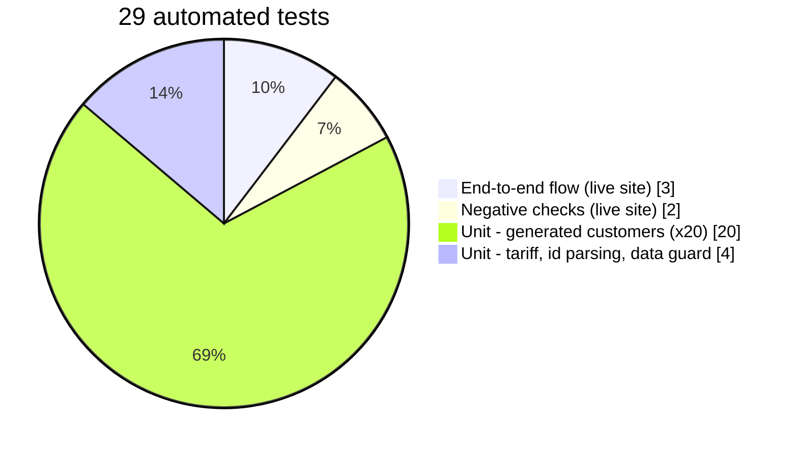
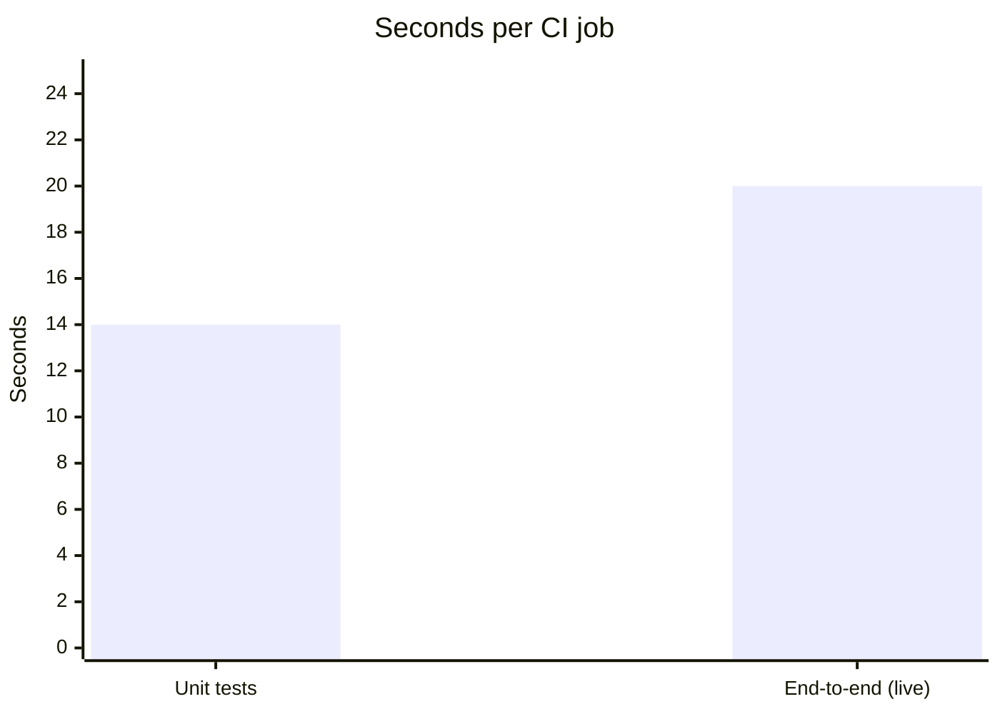
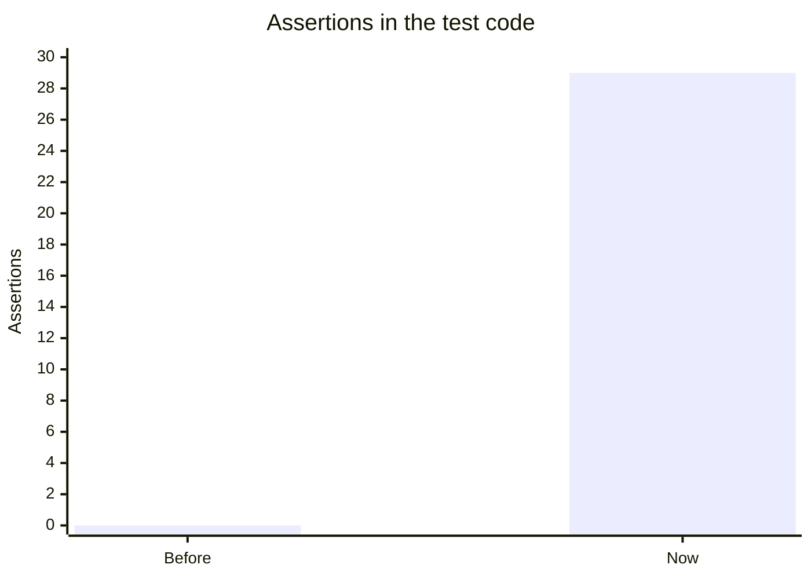
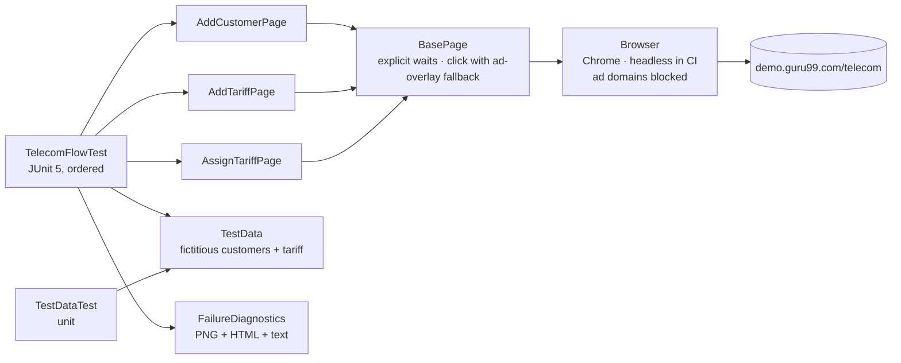
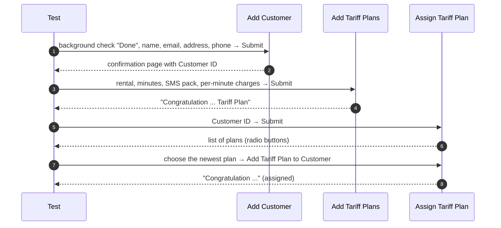
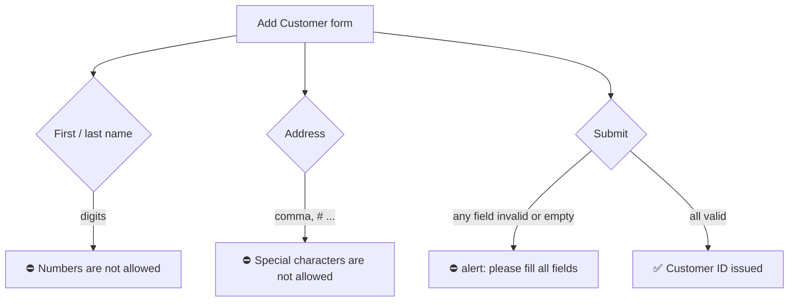
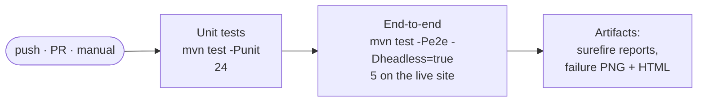
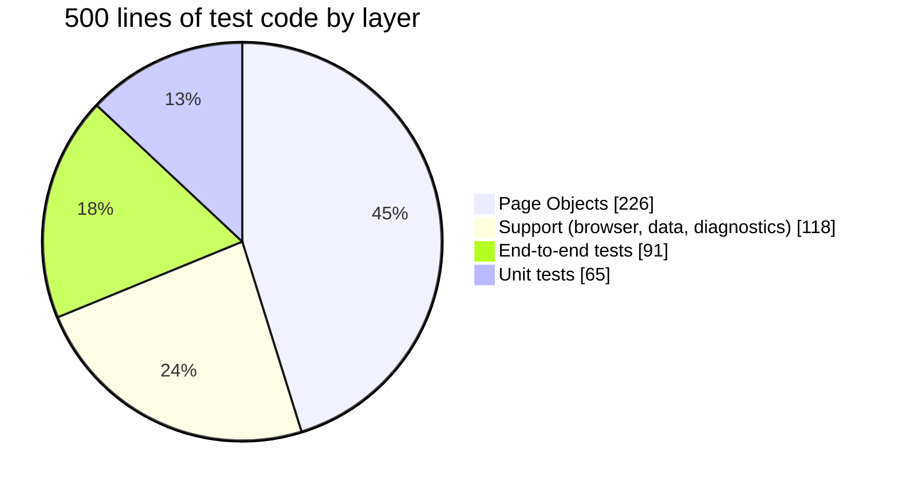

<div align="center">

# 📞 Guru99 Telecom — Selenium Test Automation (Java · JUnit 5)

### End-to-end tests for the Guru99 Telecom demo: add a customer, create a tariff plan and assign it, with Page Objects, explicit waits and a live run on every push

[](https://git.io/typing-svg)

<!-- ============ STATUS BAR ============ -->
[](https://github.com/rbchy/Guru99TelTest/actions/workflows/ci.yml)


</div>

---

## 📌 At a Glance

<table>
<tr>
<td width="50%" valign="top">

**🙋 What this is**

A small, complete Selenium framework for the **[Guru99 Telecom demo](https://demo.guru99.com/telecom/)**, a practice site for a telecom provider's back office. It walks through the core business flow the way a support agent would:

1. register a customer;
2. create a tariff plan;
3. assign that plan to the customer.

It also includes two negative checks of the site's validation.

It uses Page Objects, explicit waits (no `Thread.sleep`) and made-up test data. When a test fails it saves a screenshot and the page HTML. GitHub Actions runs the unit tests and the live flow in headless Chrome on every push.

</td>
<td width="50%" valign="top">

**📍 Quick facts**

| | |
|---|---|
| 🌐 **Target** | demo.guru99.com/telecom (live) |
| 🧪 **Tests** | 5 end-to-end · 24 unit |
| ✅ **CI** | 29 / 29 · ≈ 35 s for both jobs |
| 🧱 **Pattern** | Page Object Model · ordered JUnit 5 flow |
| 🛡️ **Data** | fictitious only, enforced by a test |
| 🧾 **On failure** | screenshot + HTML + visible text in the log |

</td>
</tr>
</table>

---

## ✅ Latest Results (GitHub Actions)

| Test | What is asserted | Result |
|---|---|:--:|
| **TC-01** Add customer | the confirmation page issues a numeric **customer id** | ✅ |
| **TC-02** Add tariff plan | *"Congratulation …"* confirmation | ✅ |
| **TC-03** Assign plan to that customer | at least one plan is offered, the newest is chosen, and *"Congratulation …"* appears | ✅ |
| **TC-04** Negative: digits in the first name | inline message *"Numbers are not allowed"* | ✅ |
| **TC-05** Negative: unknown customer id | no plans are offered | ✅ |
| **Unit** (`TestDataTest`) | 20 random customers meet the form rules · tariff values · id parsing · no real personal data in `src/` | ✅ 24 / 24 |





### Before → after this update



| | Before | Now |
|---|---|---|
| Compiles | ❌ the file name did not match the class name; no `pom.xml` | ✅ Maven project |
| Can a test fail? | ❌ `main()` printed "Failed …" and carried on | ✅ JUnit assertions |
| Tariff really assigned? | ❌ the plan was never chosen | ✅ plan chosen, confirmation asserted |
| Waiting | `Thread.sleep(5000)` × 6 = 30 s fixed | explicit waits, whole flow ≈ 10 s |
| Test data | the author's real address and mobile number | fictitious (`example.com`, 555-01xx) |
| CI | none | unit + live flow on every push |

---

## 🏗️ Architecture



### 🔄 The business flow



### 🧾 Form rules the site enforces (and the tests respect)



> The comma rule was found by this framework's own diagnostics. The first CI run failed with *"please fill all fields"*. The page object then reported `message3 = Special characters are not allowed` for the address *"545 Test Street, Springfield"*, and the test data was fixed (a unit test now enforces it).

### 🔁 CI pipeline



---

## ▶️ Running the Tests

**You need:** JDK 17+, Maven 3.8+ and Google Chrome. Selenium Manager downloads the matching driver.

```bash
mvn test -Punit                     # unit tests, no browser
mvn test -Pe2e                      # live flow in a visible Chrome window
mvn test -Pe2e -Dheadless=true      # same, headless (what CI runs)
```

If a test fails, look in `target/failures/<test>.png` and `<test>.html`. The URL, title and visible text are also printed in the console.

---

## 📁 Project Structure

```text
Guru99TelTest/
├── .github/workflows/ci.yml
├── src/test/java/com/rbctcs/guru99/
│   ├── pages/      BasePage · AddCustomerPage · AddTariffPage · AssignTariffPage
│   ├── support/    Browser · TestData · FailureDiagnostics
│   ├── e2e/        TelecomFlowTest        (5 ordered tests on the live site)
│   └── unit/       TestDataTest           (24 tests, no browser)
├── pom.xml         Selenium 4.27 · JUnit 5.11 · profiles `unit` and `e2e`
└── LICENSE         MPL 2.0
```



---

## 🧹 Maintenance Log

The README was checked against the code, and these issues were fixed:

| Issue found | Fix |
|---|---|
| ❌ **The code did not compile.** `Guru99TelTestCase.java` declared the public class `Guru99TelTestClass` in `package com.example` at the repo root, and there was no `pom.xml`. | Rebuilt as a Maven project with packages and Page Objects |
| 🙈 **Nothing could fail.** `main()` printed "Failed to …" and carried on, and errors were caught and printed. | JUnit 5 tests with assertions; failures save a screenshot, the HTML and the page text |
| 📋 **The tariff was never assigned.** After entering the customer id, the old code never chose a plan or confirmed. | TC-03 chooses the newest plan, confirms it, and asserts the *Congratulation* page |
| 🏠 **Real personal data.** The test typed a real home address and mobile number into a public demo site, and published them in the source. | Fictitious data only (`example.com`, 555-01xx phone numbers), with a unit test that fails if a real-looking number or that address returns |
| ⏱️ **Fixed waits.** Six `Thread.sleep(5000)` calls took 30 s, and the static driver was shared. | Explicit waits. The whole live flow takes about 10 s. |
| 📣 **Ad overlays.** The demo site's Google "vignette" ads can steal clicks. | Ad domains are blocked in Chrome, and clicks fall back to JavaScript when intercepted |
| 📝 **The README was a single word** ("RbcTcs") | This README |

---

## 📈 Roadmap

- [ ] Pay Billing: check the usage and charges of the assigned plan
- [ ] Data-driven negative cases (email format, phone length, tariff limits) with `@ParameterizedTest`
- [ ] Add-customer variants: *Pending* background check, Reset button
- [ ] Allure report as a CI artifact
- [ ] Nightly scheduled run to catch changes on the demo site

---

## 🔗 Related Projects

| Project | Stack |
|---|---|
| 🛒 [Amazon · Google · Gmail BDD](https://github.com/rbchy/AmazonSeleniumTest) | Selenium · Cucumber · bot-wall aware CI |
| 🏔️ [NorthFace × Automation Exercise BDD](https://github.com/rbchy/NorthFace_AutomationExercise-BDD-Test-Automation) | Selenium · Cucumber · RestAssured · CI |
| 🏦 [ParaBank Banking Automation](https://github.com/rbchy/ParaBank-BankingAutomationJavaSelenium) | Java · Selenium · CI |
| 📱 [WDIO Native Demo App – Appium](https://github.com/rbchy/WebdriverIO-Native-DemoApp-MobileTestAutomationJavaAppiumTestNG) | Appium 2 · TestNG · Android emulator in CI |

<sub>All projects: [github.com/rbchy](https://github.com/rbchy)</sub>

---

## ⚠️ Disclaimer

This is a portfolio / training project against a public practice site owned by Guru99. Every run creates a few fictitious records there. Never use real personal data on demo sites.

---

## 👤 Author

<div align="center">

**Ranajit Baran Chowdhury (RB Chowdhury)**
QA Automation Engineer / SDET · West Norriton, Pennsylvania, USA

[](https://www.linkedin.com/in/rbchy/)
[](https://github.com/rbchy)
[](https://rbchy.github.io/rbchy/)
[](https://rbc6543.wixsite.com/rbc-portfolio)
[](mailto:chyranajit@gmail.com)

<sub>Licensed under the Mozilla Public License 2.0 — see [LICENSE](LICENSE).</sub>

⭐ *If this project helps you, a star on the repo is appreciated.*

</div>
